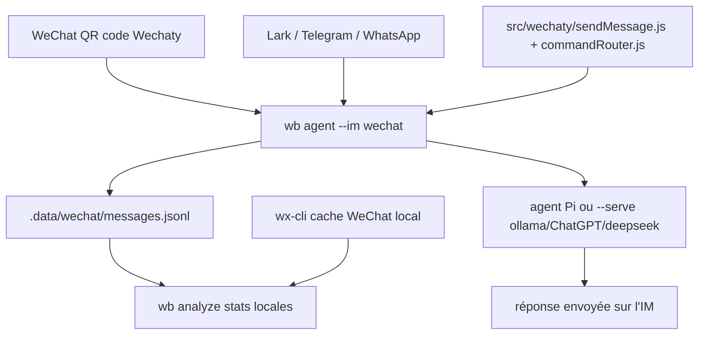

# wangrongding/wechat-bot

> CLI gateway that connects WeChat, Lark, Telegram and WhatsApp to language models.

## The problem
Plugging a model into a messaging app requires one connector per platform, each with its own way of receiving messages.
And a naive bot answers every message, which makes it unusable in groups.

## What it actually does
Routes incoming messages — WeChat via QR code with Wechaty, Lark events, Telegram Bot API long-polling, WhatsApp Cloud API webhook — to ChatGPT, DeepSeek, Ollama, Claude or Pi.
Strict triggers by design: `ALIAS_WHITELIST` in private, `ROOM_WHITELIST` plus a mention of `BOT_NAME` in groups, optional prefix.
Accesses the local WeChat cache through `wx-cli` (`wb wx sessions|history|members|stats|favorites|sns-feed`) and captures messages as JSONL.
Analyzes a group or a friend (`wb analyze --room ... --stats-only` locally, or `--serve` for a model-based analysis).

## How it is wired


## Trying it
```sh
npm i
cp .env.example .env
npm link
wb agent --im wechat --agent pi
wb wx init
wb analyze --room "Group name" --stats-only
npm run test:analysis
docker build . -t wechat-bot
docker run -d --rm --name wechat-bot -v $(pwd)/.env:/app/.env wechat-bot
```

## Cost and gotchas
Node ≥ 18, plus the key and balance of the chosen provider if you are not on Ollama or a local Pi.
The README is explicit: the WeChat web protocol risks a warning or a ban of the account, the author of the `padlocal` protocol no longer maintains it, and `wechaty` itself is not actively maintained.

## What it is not
Not an official bot: on the WeChat side, it is an unsupported protocol, with account risk borne by the user.
Not automatic: without whitelists and a mention, nothing triggers — this is intentional.
Not multimodal: non-text messages do not go into the reply pipeline.

## Alternatives
- gpt4free, chatanywhere: API platforms cited as model sources, not substitutes for the bot.
- prm-cli: npm registry switcher, side utility.

## For you
Rule out: the ban risk and an unmaintained dependency are not worth it for professional use.
