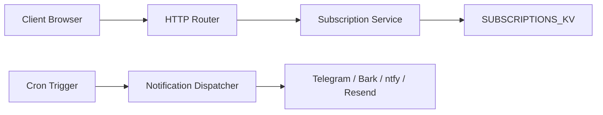

# wangwangit/SubsTracker

> Personal Cloudflare Workers application that reminds you of subscription due dates through ten notification channels.

## The problem
Subscriptions, domains and prepaid cards reach their due date without anyone thinking about it, and renewals go unnoticed.

## What it actually does
- Web interface to manage subscriptions: periods, amounts, categories, lunar calendar, renewal, payment history.
- An hourly cron checks the reminder rules (exactly N days before, the same day, after the due date) and avoids duplicates.
- Sends to Telegram, Bark, ntfy, WeChat Work, Resend e-mail, Webhook, etc., with delivery and scheduling logs.
- Data in Workers KV; JSON export and import.

## How it is wired


## Trying it
```bash
git clone https://github.com/wangwangit/SubsTracker.git
cd SubsTracker
npm install
export CLOUDFLARE_API_TOKEN=votre_token
npm run deploy:safe
```

## Cost and gotchas
Requires a Cloudflare account and an API token. Default credentials are `admin` / `password` and must be changed immediately, otherwise an exposed instance can be taken over. README in Chinese.

## What it is not
Neither a multi-user tool nor an enterprise approval workflow (the README says so). Not a full budget manager. A "7 days" reminder only fires at exactly D-7.

## Alternatives
No alternative named in the README.

## For you
Watch: useful as a small self-hosted personal tool, unrelated to data; weigh the dependency on Cloudflare and the Chinese documentation.
