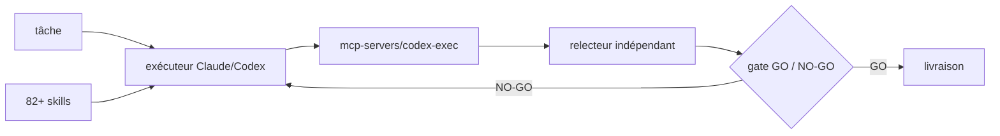

# wanshuiyin/Auto-claude-code-research-in-sleep

> Autonomous research method where one agent executes and a second model reviews.

## The problem
An agent that evaluates itself validates its own mistakes; you need a reviewer that does not share its context.

## What it actually does
The README describes a methodology rather than a product: the executor works, an independent model (Codex by default) plays the reviewer, and design and implementation "gates" must turn green before delivery. Shipped as a set of 82–83 skills installable in Claude Code, Codex CLI, Cursor, Copilot CLI and others, plus a standalone ARIS-Code CLI and plugins. Most of the README is a very detailed release log (v0.4.5 to v0.4.27): reviewer switched to a `codex exec` bridge after `codex mcp-server` was removed in codex-cli 0.154, chained model-availability fallback, folding of tool output, multi-byte UTF-8 streaming fixes, MCP version negotiation.

## How it is wired


## Trying it
```bash
npx skills add wanshuiyin/Auto-claude-code-research-in-sleep
```

## Cost and gotchas
Two models run on every task, and the gates take several rounds: the cost per task is a multiple of a single agent. Depends on third-party subscriptions (ChatGPT for Codex, Claude) and breaks when an upstream CLI changes — which is exactly what the changelog tells. No license declared.

## What it is not
Not a stable framework: a repo driven by one person, at the pace of 23 releases in a few months, whose README is 90% a log of fixes. The README is truncated before the end. The gate verdicts quoted are self-reported.

## Alternatives
- ARIS-Code CLI: the same method packaged as a standalone CLI, same author.

## For you
The idea of "executor + independent reviewer with a gate" is worth stealing; the repo itself is too unstable and too expensive to run. Ignore.
