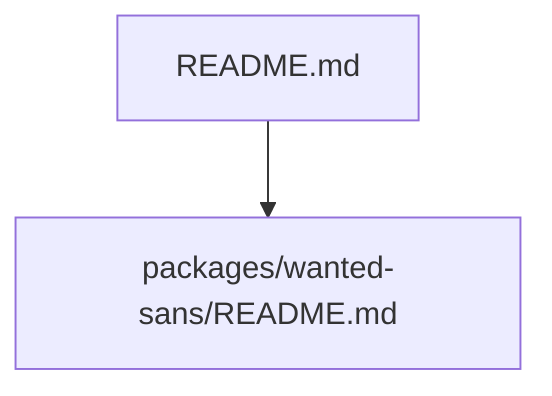

# wanteddev/wanted-sans

> Wanted Sans typeface under the OFL-1.1 license, but the README says almost nothing about it.

## The problem
Not documented: the README only contains a pointer to `/packages/wanted-sans/README.md`.

## What it actually does
Not documented. The catalog facts give an OFL-1.1 license, a last push in May 2024 and no archiving.

## How it is wired
Simplified diagram based on the card, no diagram provided.

## Trying it
No documented command.

## Cost and gotchas
OFL-1.1 license according to the catalog. Insufficient material to estimate more.

## What it is not
Nothing says whether it is a typeface, an npm package or something else: the name suggests a typeface, with no proof in the README.

## Alternatives
No alternative named in the README.

## For you
Ignore: no usable information, and no apparent connection to data or MLOps work.
