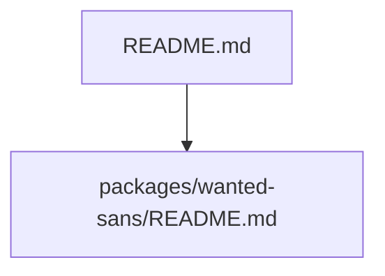

# wanteddev/wanted-sans

> Police de caractères Wanted Sans sous licence OFL-1.1, mais le README n'en dit presque rien.

## Le problème
Non documenté : le README ne contient qu'un renvoi vers `/packages/wanted-sans/README.md`.

## Ce que ça fait vraiment
Non documenté. Les faits du catalogue donnent une licence OFL-1.1, un dernier push en mai 2024 et aucun archivage.

## Comment c'est branché
Schéma simplifié d'après la fiche, sans diagramme fourni.

## Essayer
Aucune commande documentée.

## Coût et pièges
Licence OFL-1.1 d'après le catalogue. Matière insuffisante pour estimer plus.

## Ce que ce n'est pas
Rien ne permet de dire s'il s'agit d'une police, d'un paquet npm ou d'autre chose : le nom suggère une police, sans preuve dans le README.

## Alternatives
Aucune alternative nommée dans le README.

## Pour toi
À ignorer : aucune information exploitable, et sans rapport apparent avec un travail data ou MLOps.

