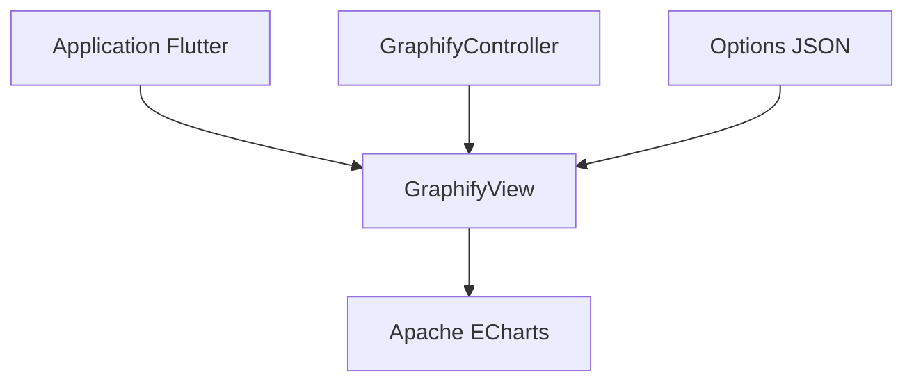

# warioddly/graphify

> Flutter package wrapping Apache ECharts to display interactive charts in a mobile app.

## The problem
Flutter has no charting library as rich as ECharts (3D, candlesticks, radar, tree).

## What it actually does
A `GraphifyView` widget driven by a `GraphifyController`, which receives an ECharts configuration as JSON and renders it. ECharts' features are the ones the README announces, without detailing them. Published on pub.dev.

## How it is wired
Simplified diagram based on the sheet, no diagram provided.



## Trying it
```dart
import 'package:graphify/graphify.dart';
```
The README also gives a bar chart example with `GraphifyView` and `initialOptions`.

## Cost and gotchas
Free. The mechanism for integrating ECharts is not detailed in the README. The installation page is just a link.

## What it is not
Not a data analysis tool, and not related to the "graphify" name used by other projects. Archived since 2025.

## Alternatives
None cited in the README.

## For you
Ignore: archived Flutter library, outside your data / AI scope.
