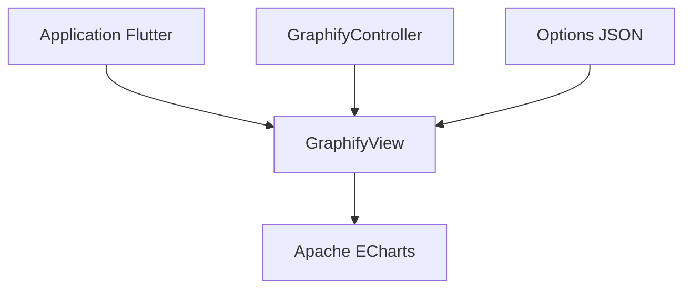

# warioddly/graphify

> Paquet Flutter reliant Apache ECharts pour afficher des graphiques interactifs dans une application mobile.

## Le problème
Flutter n'a pas de bibliothèque de graphiques aussi riche qu'ECharts (3D, bougies, radar, arbre).

## Ce que ça fait vraiment
Un widget `GraphifyView` piloté par un `GraphifyController`, qui reçoit une configuration ECharts en JSON et la rend. Les fonctions d'ECharts sont celles que le README annonce, sans les détailler. Publié sur pub.dev.

## Comment c'est branché
Schéma simplifié d'après la fiche, sans diagramme fourni.



## Essayer
```dart
import 'package:graphify/graphify.dart';
```
Le README donne aussi un exemple de diagramme en barres avec `GraphifyView` et `initialOptions`.

## Coût et pièges
Gratuit. Le mécanisme d'intégration d'ECharts n'est pas détaillé dans le README. La page d'installation est un lien.

## Ce que ce n'est pas
Pas un outil d'analyse de données ni un lien avec le nom « graphify » d'autres projets. Archivé depuis 2025.

## Alternatives
Aucune citée dans le README.

## Pour toi
À ignorer : bibliothèque Flutter archivée, hors de ton périmètre data / IA.

