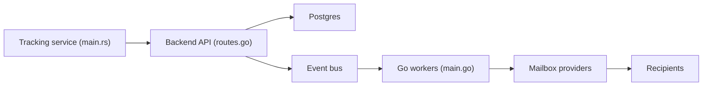

# warmbly/warmbly

> Self-hosted cold email campaign platform with mailbox warm-up, CRM and unified inbox.

## The problem
Sending cold emails from your own mailboxes without ending up in spam requires several tools: sequences, warm-up, reply tracking, deliverability.

## What it actually does
Multi-step campaigns with per-mailbox caps and spacing, unified inbox, CRM (contacts, pipelines, deals), warm-up via a pool of monitored mailboxes, bounce and complaint tracking, visual automations with AI steps, integrations (HubSpot, Slack, Zapier, REST API, webhooks). A control plane (API, consumer, Postgres, Redis, event bus) holds the state; interchangeable Go workers send and sync, without touching Postgres. Secrets are encrypted (local AES key or AWS KMS).

## How it is wired


## Trying it
```bash
curl -fsSL https://warmbly.com/install.sh | sh
git clone https://github.com/warmbly/warmbly && cd warmbly
make dev
make up
make doctor
```

## Cost and gotchas
Docker with Compose v2; about 10 GB of disk for a local build. `make dev` and `make up` share one database: do not mix development and self-hosting on the same machine. Mass cold sending exposes you to anti-spam rules.

## What it is not
Not a simple newsletter tool: it targets cold prospecting and mailbox warm-up, a use that may violate provider rules or regulations. The project dates from January 2026.

## Alternatives
No alternative named in the README (HubSpot, Slack and Zapier appear there as integrations).

## For you
Worth watching: the control/execution architecture is instructive and self-hosting is simple, but the subject is commercial prospecting, far from MLOps.
