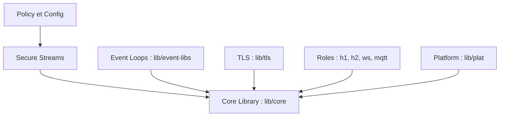

# warmcat/libwebsockets

> Lightweight C library for HTTP/1, HTTP/2, HTTP/3, WebSockets and MQTT clients and servers.

## The problem
You need a compact, portable and secure network client or server, from microcontroller to cloud.

## What it actually does
A C library that implements HTTP/1, 2 and 3, WebSockets, WebTransport and MQTT, as well as JSON, CBOR, JOSE and COSE. It works with many TLS stacks (OpenSSL, MbedTLS, GnuTLS, BoringSSL, SChannel…) and integrates with the libuv, libevent, libev, glib or uloop event loops. It provides more than a hundred minimal examples. Version 5.1 separates the "no I/O" part from I/O.

## How it is wired

## Trying it
The README gives no build command: it points to cmake. The documented option enables DHT: `-DLWS_WITH_DHT=1`.

## Cost and gotchas
Free. The license is "present but unidentified" by GitHub (the README states MIT). Use 5.1 stable or main: versions before 5.1 are discouraged because of security fixes. QUIC and HTTP/3 require GnuTLS or BoringSSL, not OpenSSL.

## What it is not
Not a high-level library: you need to master C and its event loops. A single person is responsible for it.

## Alternatives
No alternative named in the README.

## For you
Worth watching: relevant only if you embed networking in C or on a microcontroller; in Python, you do not need it.
