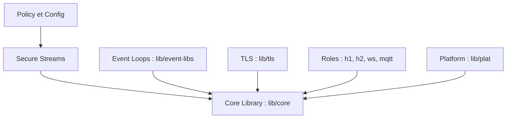

# warmcat/libwebsockets

> Bibliothèque C légère pour clients et serveurs HTTP/1, HTTP/2, HTTP/3, WebSockets et MQTT.

## Le problème
Il faut un client ou serveur réseau compact, portable et sécurisé, du microcontrôleur au cloud.

## Ce que ça fait vraiment
Une bibliothèque C qui implémente HTTP/1, 2 et 3, WebSockets, WebTransport et MQTT, ainsi que JSON, CBOR, JOSE et COSE. Elle fonctionne avec de nombreuses piles TLS (OpenSSL, MbedTLS, GnuTLS, BoringSSL, SChannel…) et s'intègre aux boucles d'événements libuv, libevent, libev, glib ou uloop. Elle fournit plus de cent exemples minimaux. La version 5.1 sépare le « sans entrées-sorties » des E/S.

## Comment c'est branché

## Essayer
Le README ne donne pas de commande de compilation : il renvoie à cmake. L'option documentée active le DHT : `-DLWS_WITH_DHT=1`.

## Coût et pièges
Gratuit. La licence est « présente mais non identifiée » par GitHub (le README annonce MIT). Utilise la 5.1 stable ou main : les versions antérieures à 5.1 sont déconseillées pour des correctifs de sécurité. Le QUIC et HTTP/3 demandent GnuTLS ou BoringSSL, pas OpenSSL.

## Ce que ce n'est pas
Ce n'est pas une bibliothèque de haut niveau : il faut maîtriser le C et ses boucles d'événements. Une seule personne en est responsable.

## Alternatives
Aucune alternative nommée dans le README.

## Pour toi
À surveiller : pertinent seulement si tu embarques du réseau en C ou sur microcontrôleur ; en Python, tu n'en as pas besoin.

