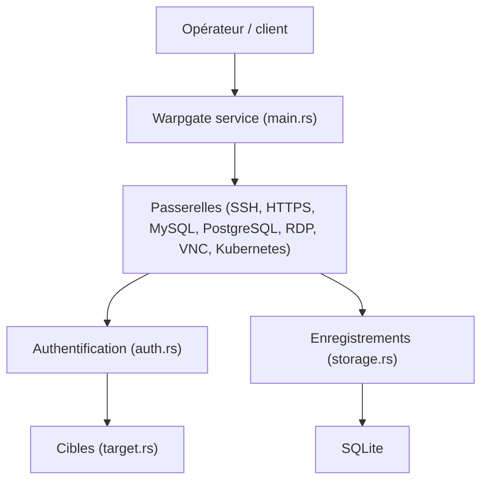

# warp-tech/warpgate

> Transparent bastion for SSH, HTTPS, Kubernetes, databases, RDP and VNC with session recording.

## The problem
Give access to internal servers and databases while tracking who does what, without an open VPN or a dedicated client.

## What it actually does
A service to deploy in a DMZ: it authenticates the user, connects to the target itself and links the two, recording the session. It handles SSH, HTTPS, Kubernetes, MySQL, PostgreSQL, RDP, VNC, with 2FA, OIDC SSO, brute-force protection and a web admin interface. History is kept in SQLite.

## How it is wired


## Trying it
```bash
warpgate setup
```
The README points to the "Getting started" page for the rest.

## Cost and gotchas
Free, single binary. You must host it in a DMZ, configure targets and users, and session recordings take up disk space. 303 open issues.

## What it is not
Not a jump host or a VPN. Not a SaaS. AI-assisted contributions are accepted with disclosure, according to the README.

## Alternatives
Teleport, compared in the README: requires a dedicated client, paid SSO, SaaS; Warpgate is presented as more transparent.

## For you
Worth watching: useful for controlling access to GPU machines or databases in your MLOps infrastructure, but only if you administer that perimeter.
