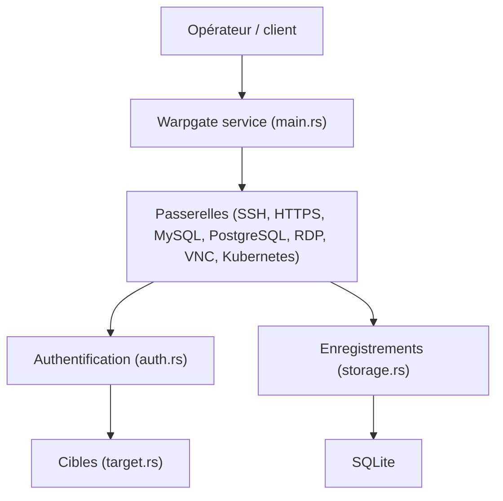

# warp-tech/warpgate

> Bastion transparent SSH, HTTPS, Kubernetes, bases de données, RDP et VNC avec enregistrement des sessions.

## Le problème
Donner accès à des serveurs et bases internes en tracant qui fait quoi, sans VPN ouvert ni client dédié.

## Ce que ça fait vraiment
Service à déployer en DMZ : il authentifie l'utilisateur, se connecte à la cible lui-même et relie les deux, en enregistrant la session. Il gère SSH, HTTPS, Kubernetes, MySQL, PostgreSQL, RDP, VNC, avec 2FA, SSO OIDC, protection anti-force brute et interface d'admin web. Historique dans SQLite.

## Comment c'est branché


## Essayer
```bash
warpgate setup
```
Le README renvoie à la page « Getting started » pour la suite.

## Coût et pièges
Gratuit, binaire unique. Il faut l'héberger en DMZ, configurer les cibles et utilisateurs, et les enregistrements de sessions occupent du disque. 303 issues ouvertes.

## Ce que ce n'est pas
Pas un jump host ni un VPN. Pas un SaaS. Les contributions assistées par IA sont acceptées sous divulgation, selon le README.

## Alternatives
Teleport, comparé dans le README : client dédié requis, SSO payant, SaaS ; Warpgate est présenté comme plus transparent.

## Pour toi
À surveiller : utile pour encadrer l'accès aux machines GPU ou aux bases de ton infra MLOps, mais seulement si tu administres ce périmètre.

