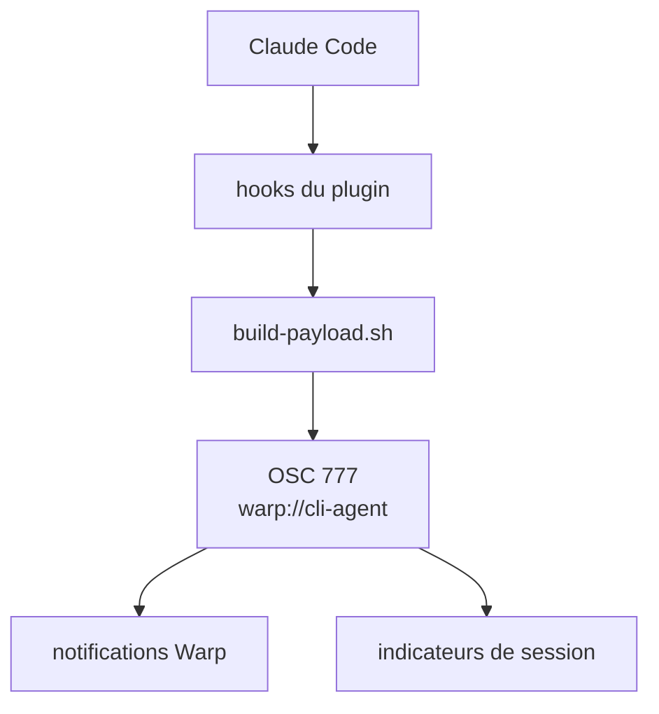

# warpdotdev/claude-code-warp

> Claude Code plugin that sends native notifications and session state to Warp.

## The problem
While Claude Code is working, you can't tell when it has finished or is waiting for approval without watching the terminal.

## What it actually does
Lifecycle hooks (SessionStart, Stop, Notification, PermissionRequest, UserPromptSubmit, PostToolUse) emit OSC 777 sequences to `warp://cli-agent`. Warp turns them into notifications and status indicators. The Stop hook reads the transcript to summarize the prompt and the response.

## How it is wired


## Trying it
```bash
/plugin marketplace add warpdotdev/claude-code-warp
/plugin install warp@claude-code-warp
```

## Cost and gotchas
Free. Requires the Warp terminal, Claude Code and `jq`. Restart Claude Code or run /reload-plugins after installing.

## What it is not
Not a terminal-independent integration: without Warp, it is useless. The hooks read your transcript.

## Alternatives
Not documented in the README.

## For you
Ignore unless Warp is your terminal: a notification convenience with no effect on data, AI or MLOps work.
