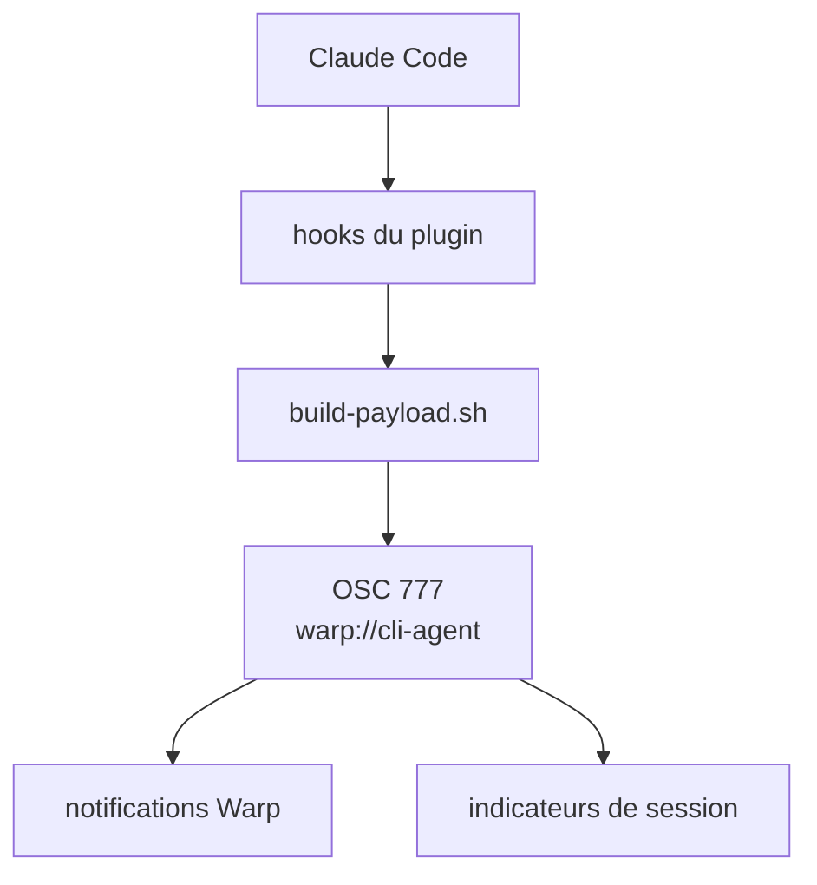

# warpdotdev/claude-code-warp

> Plugin Claude Code qui envoie à Warp des notifications natives et l'état de session.

## Le problème
Pendant que Claude Code travaille, on ne sait pas quand il a fini ou attend une validation sans surveiller le terminal.

## Ce que ça fait vraiment
Des hooks de cycle de vie (SessionStart, Stop, Notification, PermissionRequest, UserPromptSubmit, PostToolUse) émettent des séquences OSC 777 vers `warp://cli-agent`. Warp en tire des notifications et des indicateurs d'état. Le hook Stop lit le transcript pour résumer prompt et réponse.

## Comment c'est branché


## Essayer
```bash
/plugin marketplace add warpdotdev/claude-code-warp
/plugin install warp@claude-code-warp
```

## Coût et pièges
Gratuit. Il faut le terminal Warp, Claude Code et `jq`. Redémarrer Claude Code ou lancer /reload-plugins après installation.

## Ce que ce n'est pas
Pas une intégration indépendante du terminal : sans Warp, elle ne sert à rien. Les hooks lisent ton transcript.

## Alternatives
Non documenté dans le README.

## Pour toi
À ignorer sauf si Warp est ton terminal : confort de notification, sans effet sur un travail data, IA ou MLOps.

