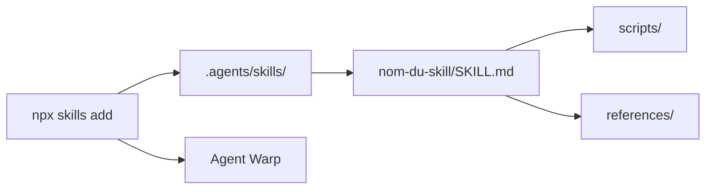

# warpdotdev/common-skills

> Shared workflow skills (specs, PRs, CI, review) reusable across repositories, by the Warp team.

## The problem
Teams copy the same workflow skills (writing a spec, a PR, fixing CI) from one repository to another, with drift and inconsistencies.

## What it actually does
A `.agents/skills/` folder with one subfolder per skill: specs (`write-product-spec`, `write-tech-spec`, `implement-specs`), development (`create-pr`, `write-pr-description`, `diagnose-ci-failures`, `fix-errors`, `resolve-merge-conflicts`, `review-pr`), research (`research`, `cross-critique`), skill authoring (`update-skill`, `skill-doctor`). Some still contain repository-specific elements, to be generalized.

## How it is wired


## Trying it
```bash
npx skills@latest add warpdotdev/common-skills --list
npx skills@latest add warpdotdev/common-skills --skill write-tech-spec --agent warp --global
npx skills@latest update --global --agent warp
```

## Cost and gotchas
Free. The README targets the Warp agent; with another agent, adapt the `--agent` option. Copied skills may still cite paths from a specific repository.

## What it is not
Not a framework: instructions to copy. Not tied to a single agent by format, but the usage docs are written for Warp.

## Alternatives
No alternative named in the README.

## For you
Adopt: workflow skills proven in a team, easy to pick one by one; take `skill-doctor` and `write-tech-spec` as a starting point.
