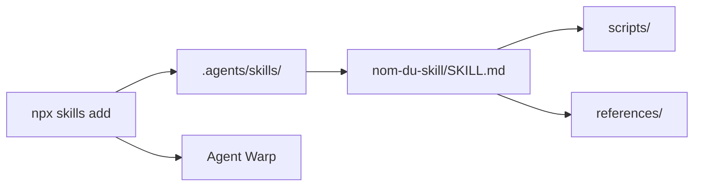

# warpdotdev/common-skills

> Skills partagés de workflow (specs, PR, CI, revue) réutilisables entre dépôts, par l'équipe Warp.

## Le problème
Les équipes recopient d'un dépôt à l'autre les mêmes skills de workflow (rédiger une spec, une PR, corriger la CI), avec dérive et incohérences.

## Ce que ça fait vraiment
Un dossier `.agents/skills/` avec un sous-dossier par skill : spec (`write-product-spec`, `write-tech-spec`, `implement-specs`), développement (`create-pr`, `write-pr-description`, `diagnose-ci-failures`, `fix-errors`, `resolve-merge-conflicts`, `review-pr`), recherche (`research`, `cross-critique`), rédaction de skills (`update-skill`, `skill-doctor`). Certains contiennent encore des éléments propres à un dépôt, à généraliser.

## Comment c'est branché


## Essayer
```bash
npx skills@latest add warpdotdev/common-skills --list
npx skills@latest add warpdotdev/common-skills --skill write-tech-spec --agent warp --global
npx skills@latest update --global --agent warp
```

## Coût et pièges
Gratuit. Le README cible l'agent Warp ; avec un autre agent, adapter l'option `--agent`. Les skills copiés peuvent encore citer des chemins d'un dépôt précis.

## Ce que ce n'est pas
Pas un framework : des consignes à copier. Pas lié à un seul agent par le format, mais la doc d'usage est écrite pour Warp.

## Alternatives
Aucune alternative nommée dans le README.

## Pour toi
À adopter : des skills de workflow éprouvés en équipe, faciles à piocher un par un ; prends `skill-doctor` et `write-tech-spec` comme point de départ.

