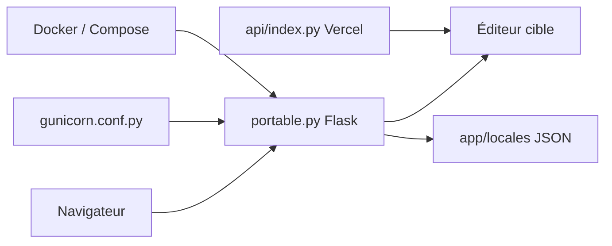

# wasi-master/13ft

> Self-hosted Flask server that fetches paywalled articles by presenting itself as Google's crawler.

## The problem
Some press or blog articles are hidden behind a paywall or overloaded with ads. The README targets Medium and the New York Times for one-off reading of a single article.

## What it actually does
- A Flask application (`app/portable.py`) receives a target URL, either typed into a home page or appended to the path (`/<url>`).
- It requests the page identifying itself as Googlebot, then tries other fallback sources if that fails.
- A waiting page is displayed during retrieval.
- No database or authentication: the interface is local and minimal, translated via `LOCALE` (en, de, fr, ko).

## How it is wired


## Trying it
```bash
git clone https://github.com/wasi-master/13ft.git
cd 13ft
docker compose up
# ou, sans Docker :
cd app/
python -m pip install -r requirements.txt
python portable.py
```

## Cost and gotchas
Free, nothing to pay. Success depends entirely on the target site (bot detection, markup changes), so results vary.

## What it is not
It is not a guaranteed way to get access: publishers can block it. Bypassing a paywall may violate the site's terms of use; the author himself encourages supporting creators. It is not an archiving tool.

## Alternatives
- 12ft.io: a similar hosted service, but less compatible according to the README.

## For you
Ignore: an access-bypass tool unrelated to data or MLOps, with questionable terms of use.
