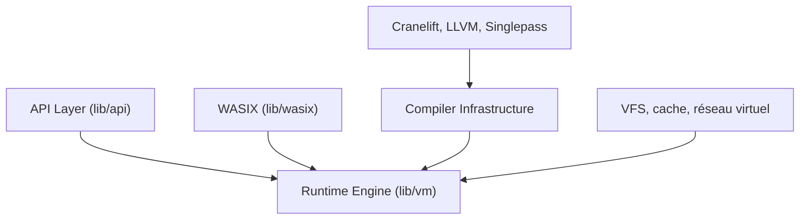

# wasmerio/wasmer

> WebAssembly runtime to run apps and AI agent code in lightweight, safe sandboxes.

## The problem
Running untrusted code, especially agent-generated code, requires fine-grained isolation of files, network and environment.

## What it actually does
CLI that downloads and runs registry packages (Python, Bash, PHP, SQLite, FFmpeg, PostgreSQL via pglite) in a sandbox. File access via `--volume`, network via `--net`. The SDK (`wasmerio/wasmer-sdk`) is in alpha for JS, Python, Rust and Swift. The repository contains the runtime, with Cranelift, LLVM and Singlepass backends.

## How it is wired


## Trying it
```sh
curl https://get.wasmer.io -sSfL | sh
wasmer run python/python -- -c "print('Hello from Wasmer')"
wasmer run wasmer/bash -- -c "echo 'Hello from Wasmer'"
npm install @wasmer/sdk
```

## Cost and gotchas
Installed via `curl | sh`. SDK is alpha; the Rust SDK is not published on crates.io. Wasmer Edge is a commercial hosting service.

## What it is not
Not a full virtual machine: packages must exist in WebAssembly. No GPU or arbitrary native libraries.

## Alternatives
No alternative named in the README.

## For you
Watch: a concrete lead for running isolated agent code, but the SDK is still alpha.
