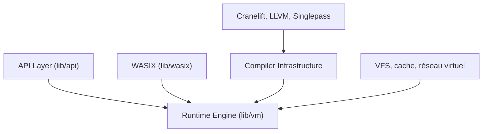

# wasmerio/wasmer

> Runtime WebAssembly pour exécuter apps et code d'agents IA dans des bacs à sable légers et sûrs.

## Le problème
Exécuter du code non fiable, notamment généré par un agent, exige isolation fine des fichiers, du réseau et de l'environnement.

## Ce que ça fait vraiment
CLI qui télécharge et exécute des paquets du registre (Python, Bash, PHP, SQLite, FFmpeg, PostgreSQL via pglite) dans un bac à sable. Accès fichiers par `--volume`, réseau par `--net`. Le SDK (`wasmerio/wasmer-sdk`) est en alpha pour JS, Python, Rust et Swift. Le dépôt contient le runtime, avec backends Cranelift, LLVM et Singlepass.

## Comment c'est branché


## Essayer
```sh
curl https://get.wasmer.io -sSfL | sh
wasmer run python/python -- -c "print('Hello from Wasmer')"
wasmer run wasmer/bash -- -c "echo 'Hello from Wasmer'"
npm install @wasmer/sdk
```

## Coût et pièges
Installation par `curl | sh`. SDK alpha ; le SDK Rust n'est pas publié sur crates.io. Wasmer Edge est un hébergement commercial.

## Ce que ce n'est pas
Pas une machine virtuelle complète : les paquets doivent exister en WebAssembly. Pas de GPU ni de bibliothèques natives arbitraires.

## Alternatives
Aucune alternative nommée dans le README.

## Pour toi
Surveiller : piste concrète pour exécuter du code d'agent isolé, mais SDK encore alpha.

