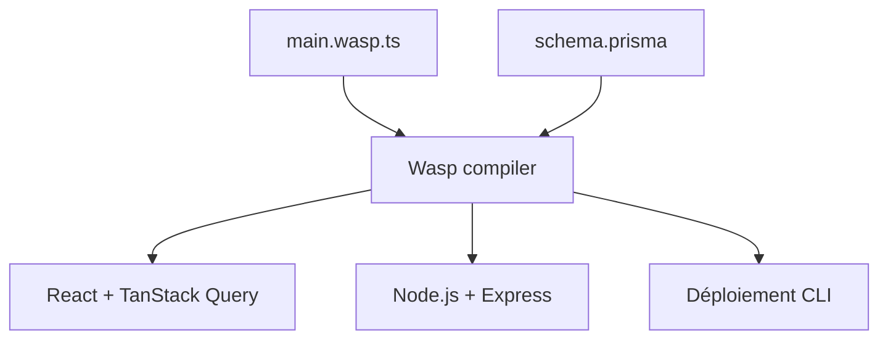

# wasp-lang/wasp

> Declarative framework for React, Node.js and Prisma web applications, with built-in auth and deployment.

## The problem
A full web application requires a lot of repetitive code: authentication, client-server RPC, sending e-mails, scheduled jobs.

## What it actually does
You describe the application in a `main.wasp.ts` file (routes, pages, queries, auth) and a Prisma schema. The Wasp compiler generates the front-end, back-end and deployment code. The generated code is visible in `.wasp/`. The README announces agent plugins (Cursor, Claude Code) and states that the project is in beta.

## How it is wired

Diagram drawn from the README, no diagram provided.

## Trying it
```bash
npm i -g @wasp/cli@latest
```

## Cost and gotchas
Free. Only one stack is supported for now. A lot of behavior is generated: debugging requires understanding the compiler's output.

## What it is not
Not a data or AI tool. Not a hosting platform: deployment targets your own provider. The README promises a "production-ready" app in a few lines, which it does not demonstrate.

## Alternatives
No alternative named in the README.

## For you
Worth watching: useful for quickly building a web interface around a model or a dashboard, but beta and centered on a single stack.
