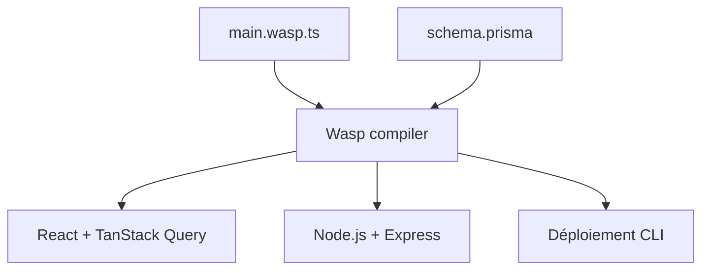

# wasp-lang/wasp

> Framework déclaratif pour applications web React, Node.js et Prisma, avec auth et déploiement intégrés.

## Le problème
Une application web complète demande beaucoup de code répétitif : authentification, RPC client-serveur, envoi d'e-mails, tâches planifiées.

## Ce que ça fait vraiment
Tu décris l'application dans un fichier `main.wasp.ts` (routes, pages, requêtes, auth) et un schéma Prisma. Le compilateur Wasp génère le code du front, du back et du déploiement. Le code généré est visible dans `.wasp/`. Le README annonce des plugins d'agents (Cursor, Claude Code) et indique que le projet est en bêta.

## Comment c'est branché

Schéma tiré du README, aucun diagramme fourni.

## Essayer
```bash
npm i -g @wasp/cli@latest
```

## Coût et pièges
Gratuit. Une seule pile prise en charge pour l'instant. Beaucoup de comportement est généré : déboguer demande de comprendre la sortie du compilateur.

## Ce que ce n'est pas
Pas un outil data ni IA. Pas une plateforme d'hébergement : le déploiement vise ton fournisseur. Le README promet une app « production-ready » en quelques lignes, ce qu'il ne démontre pas.

## Alternatives
Aucune alternative nommée dans le README.

## Pour toi
À surveiller : utile pour monter vite une interface web autour d'un modèle ou d'un tableau de bord, mais bêta et centré sur une seule pile.

