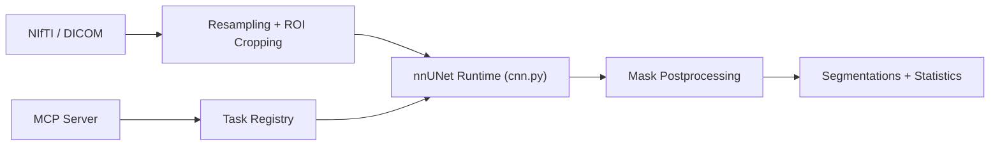

# wasserth/TotalSegmentator

> Automatic segmentation of anatomical structures on CT and MRI images, via command line or Python API.

## The problem
Outlining organs, bones and vessels on 3D scans by hand is slow; you need a model that generalizes to varied scanners and protocols.

## What it actually does
nnU-Net models trained on 1,228 CTs and 616 MRIs. The default `total` task segments 117 classes (50 in MRI), with many subtasks (lungs, liver, teeth, brain, muscles…). Input NIfTI or DICOM; output NIfTI or DICOM. Options `--fast`, `--roi_subset`, statistics, radiomics. Reports on aorta, pulmonary artery, spine. An MCP server is provided. Weights are downloaded automatically.

## How it is wired


## Trying it
```bash
pip install TotalSegmentator
TotalSegmentator -i ct.nii.gz -o segmentations
TotalSegmentator -i mri.nii.gz -o segmentations --task total_mr
totalseg_info --list-tasks
```

## Cost and gotchas
Free for the open tasks (Apache-2.0). Several tasks (high-resolution heart, appendicular bones, tissues, brain) require a license: free for non-commercial use, paid otherwise; `brain_aneurysm` is CC BY-NC with no commercial license. Anonymous usage statistics are sent, and can be disabled. GPU recommended; on CPU use `--fast`.

## What it is not
Not a medical device, says the README, even though it is part of FDA-cleared products. Citing the papers is mandatory.

## Alternatives
Not documented in the README (the project builds on nnU-Net).

## For you
Watch: very good for medical imaging, but the per-task licenses and the clinical domain limit it to a specific need.
