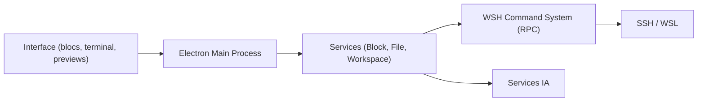

# wavetermdev/waveterm

> Open-source graphical terminal with an AI assistant and durable SSH sessions, for macOS, Linux and Windows.

## The problem
Classic terminals separate the shell, the remote editor, file previews and the AI assistant. SSH sessions drop at every network interruption.

## What it actually does
An Electron desktop application with a Go backend and a SQLite database. It organizes draggable "blocks" (terminal, editor, browser, AI, remote file previews). SSH sessions reconnect automatically. Wave AI reads the terminal output and edits files with approval. Models plug in with your own keys (OpenAI, Claude, Gemini) or locally via Ollama and LM Studio. A `wsh` command drives the workspace.

## How it is wired

## Trying it
The README points to the download at www.waveterm.dev/download and to the per-platform installation docs; no command appears in it.

## Cost and gotchas
Free; no account needed. Model API keys are at your expense, except for AI credits included during the free beta. Minimum requirements: macOS 11, Windows 10 1809, glibc 2.28.

## What it is not
Command execution by the AI is "coming soon" and not there yet. The provided architecture diagram is a generic description, not a survey of the code.

## Alternatives
No alternative cited in the README.

## For you
Worth watching: handy for working on remote GPU machines with local AI assistance, but it remains a comfort tool, not a building block of the pipeline.
