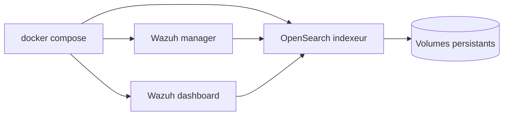

# wazuh/wazuh-docker

> Docker files to deploy the Wazuh security platform: manager, dashboard and OpenSearch.

## The problem
Installing the Wazuh stack (manager, indexer, dashboard) by hand is slow and fragile.

## What it actually does
The repo provides the resources to launch the full Wazuh stack in containers with `docker compose`. It offers a multi-node mode, persistent volumes and configurations for testing or production. Branches follow the versions (X.Y.Z), `main` is for development. The Dockerfiles descend from those of "deviantony" and "xetus-oss".

## How it is wired
Simplified diagram based on the sheet, no diagram provided.

## Trying it
No command documented in the README: it points to the official documentation (documentation.wazuh.com, Docker page) and to the `docs` folder.

## Cost and gotchas
Docker required, and the OpenSearch stack is resource-hungry (figures not documented). The license is present but not identified by GitHub: to be checked.

## What it is not
It is not Wazuh itself, only its Docker packaging. The README gives neither a step-by-step procedure nor hardware prerequisites. It is not an AI tool.

## Alternatives
No alternative named in the README.

## For you
Worth watching only if you have to supervise the security of an MLOps infrastructure: this is intrusion detection, not data or AI.
