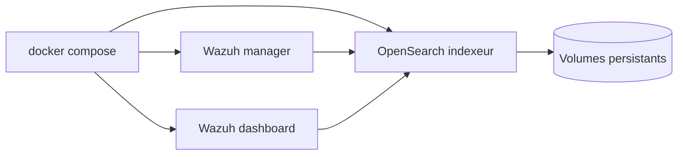

# wazuh/wazuh-docker

> Fichiers Docker pour déployer la plateforme de sécurité Wazuh : manager, dashboard et OpenSearch.

## Le problème
Installer à la main la pile Wazuh (manager, indexeur, dashboard) est long et fragile.

## Ce que ça fait vraiment
Le dépôt fournit les ressources pour lancer la pile Wazuh complète en conteneurs avec `docker compose`. Il propose un mode multi-nœuds, des volumes persistants et des configurations pour le test ou la production. Les branches suivent les versions (X.Y.Z), `main` sert au développement. Les Dockerfiles descendent de ceux de « deviantony » et « xetus-oss ».

## Comment c'est branché
Schéma simplifié d'après la fiche, sans diagramme fourni.

## Essayer
Aucune commande documentée dans le README : il renvoie à la documentation officielle (documentation.wazuh.com, page Docker) et au dossier `docs`.

## Coût et pièges
Docker requis, et la pile OpenSearch est gourmande (chiffres non documentés). La licence est présente mais non identifiée par GitHub : à vérifier.

## Ce que ce n'est pas
Ce n'est pas Wazuh lui-même, seulement son empaquetage Docker. Le README ne donne ni procédure pas à pas ni prérequis matériels. Ce n'est pas un outil d'IA.

## Alternatives
Aucune alternative nommée dans le README.

## Pour toi
À surveiller seulement si tu as à superviser la sécurité d'une infra MLOps : c'est de la détection d'intrusion, pas de la donnée ni de l'IA.

