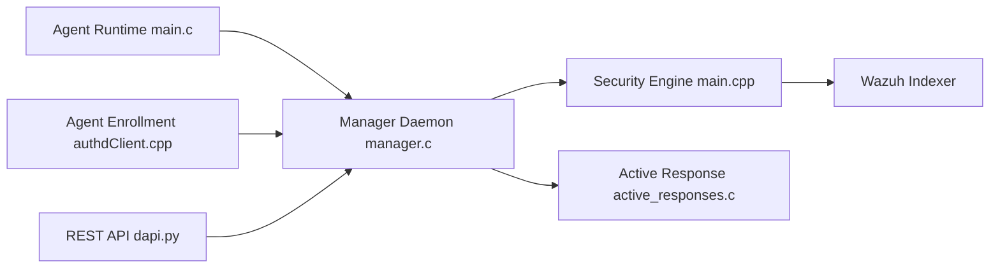

# wazuh/wazuh

> Open source threat detection and response platform: agents on machines, a central analysis server.

## The problem
Without centralized monitoring, there is no way to know that a host, a container or a cloud account has been modified or compromised.

## What it actually does
Agents collect logs, file integrity data and software inventory; the manager analyzes them with rules, correlates them with CVE databases, assesses compliance (PCI DSS, GDPR) and can trigger active responses. It also monitors AWS, Azure, Google Cloud and Docker. Alerts can be browsed through the Indexer and the web interface.

## How it is wired

## Trying it
No installation command in the README: it points to the Wazuh installation guide and offers orchestration tools (Docker, Ansible, Kubernetes, etc.).

## Cost and gotchas
Free, but you need to deploy the manager, the Indexer and the agents. More than 3,000 open issues. The `main` branch may contain bugs, according to the README.

## What it is not
Not an offensive tool: it is defense. The license is mixed (GPLv2, AGPLv3 for the engine, dual license for some libraries) and GitHub does not identify it: check before any commercial use.

## Alternatives
- OSSEC: the project Wazuh is derived from.

## For you
Worth watching: useful if you run an MLOps infrastructure that needs monitoring, but heavy to deploy and the mixed license requires a careful read.
