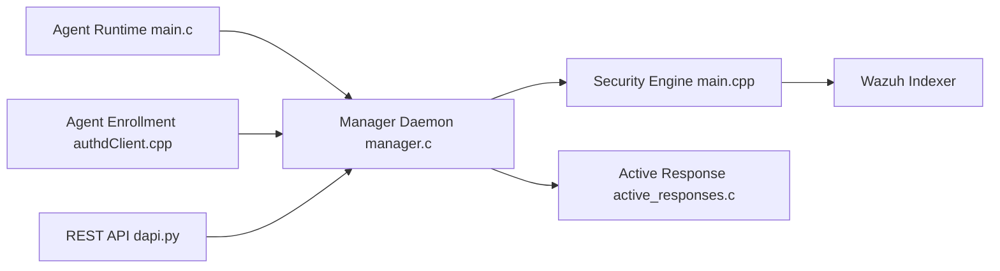

# wazuh/wazuh

> Plateforme libre de détection et réponse aux menaces : agents sur les machines, serveur d'analyse central.

## Le problème
Sans supervision centralisée, impossible de savoir qu'un hôte, un conteneur ou un compte cloud a été modifié ou compromis.

## Ce que ça fait vraiment
Des agents collectent journaux, intégrité des fichiers et inventaire logiciel ; le manager les analyse par règles, corrèle avec des bases de CVE, évalue la conformité (PCI DSS, GDPR) et peut déclencher des réponses actives. Il surveille aussi AWS, Azure, Google Cloud et Docker. Les alertes sont consultables via l'Indexer et l'interface web.

## Comment c'est branché

## Essayer
Aucune commande d'installation dans le README : il renvoie au guide d'installation Wazuh et propose des outils d'orchestration (Docker, Ansible, Kubernetes, etc.).

## Coût et pièges
Gratuit, mais il faut déployer manager, Indexer et agents. Plus de 3 000 issues ouvertes. La branche `main` peut contenir des bugs, selon le README.

## Ce que ce n'est pas
Ce n'est pas un outil offensif : c'est de la défense. La licence est mixte (GPLv2, AGPLv3 pour le moteur, double licence pour certaines bibliothèques) et GitHub ne l'identifie pas : à vérifier avant tout usage commercial.

## Alternatives
- OSSEC : projet dont Wazuh est dérivé.

## Pour toi
À surveiller : utile si tu opères une infra MLOps à superviser, mais lourd à déployer et la licence mixte demande une lecture.

