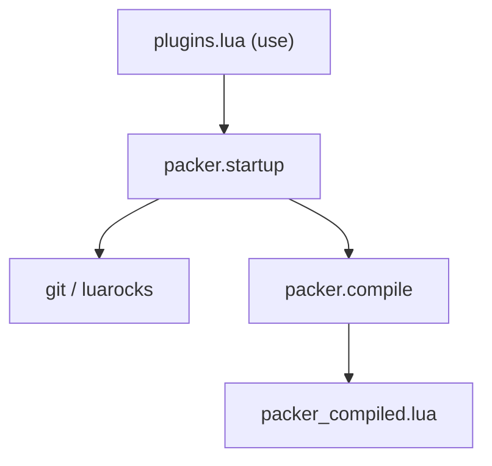

# wbthomason/packer.nvim

> Neovim plugin manager in Lua, inspired by use-package, now unmaintained.

## The problem
Installing, updating and lazy-loading Neovim plugins declaratively.

## What it actually does
You declare plugins in Lua with `use`. Packer installs them via git, handles dependencies, Luarocks rocks, hooks and snapshots, then compiles a lazy loader. Commands (PackerSync, PackerUpdate...) drive everything. The README notes that the repository is no longer maintained.

## How it is wired
Simplified diagram based on the sheet, no diagram provided.


## Trying it
```bash
git clone --depth 1 https://github.com/wbthomason/packer.nvim\
 ~/.local/share/nvim/site/pack/packer/start/packer.nvim
nvim --headless -c 'autocmd User PackerComplete quitall' -c 'PackerSync'
```

## Cost and gotchas
Free, Neovim 0.5 or later. The config and setup functions must not have captured variables (upvalues). Last push in March 2024.

## What it is not
Not maintained: the README itself points to other tools.

## Alternatives
- lazy.nvim: the most stable and maintained according to the README.
- pckr.nvim: spiritual successor, less stable.

## For you
Ignore: choose lazy.nvim, since packer is abandoned.
