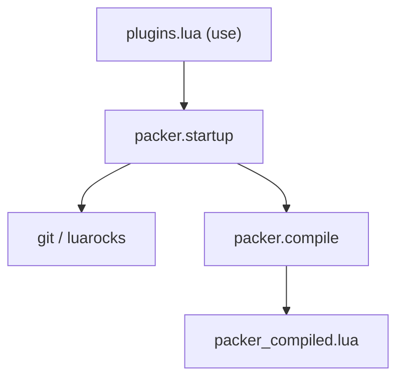

# wbthomason/packer.nvim

> Gestionnaire de plugins Neovim en Lua, inspiré de use-package, désormais non maintenu.

## Le problème
Installer, mettre à jour et charger paresseusement des plugins Neovim de façon déclarative.

## Ce que ça fait vraiment
On déclare les plugins en Lua avec `use`. Packer les installe via git, gère dépendances, rocks Luarocks, hooks et instantanés, puis compile un chargeur paresseux. Des commandes (PackerSync, PackerUpdate...) pilotent le tout. Le README signale que le dépôt n'est plus maintenu.

## Comment c'est branché
Schéma simplifié d'après la fiche, sans diagramme fourni.


## Essayer
```bash
git clone --depth 1 https://github.com/wbthomason/packer.nvim\
 ~/.local/share/nvim/site/pack/packer/start/packer.nvim
nvim --headless -c 'autocmd User PackerComplete quitall' -c 'PackerSync'
```

## Coût et pièges
Gratuit, Neovim 0.5 ou plus. Les fonctions config et setup ne doivent pas avoir de variables capturées (upvalues). Dernier push en mars 2024.

## Ce que ce n'est pas
Ce n'est pas maintenu : le README renvoie lui-même vers d'autres outils.

## Alternatives
- lazy.nvim : le plus stable et maintenu selon le README.
- pckr.nvim : successeur spirituel, moins stable.

## Pour toi
À ignorer : choisis lazy.nvim, car packer est abandonné.

