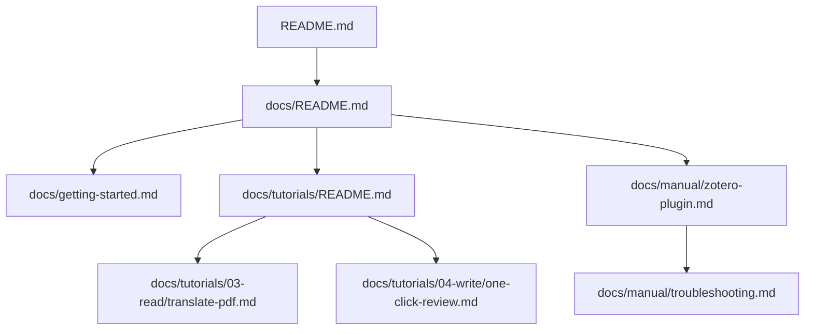

# wdcpclover/ai4paper

> Documentation for a Zotero plugin and a paid web service that helps with reading and literature review.

## The problem
Reading, translating, sorting and synthesizing dozens of scientific articles forces you to juggle several tools.

## What it actually does
The repository contains only documentation: no source code. It describes a commercial service (Zotero 7 to 10 plugin, web, WeChat mini-program): PDF translation, questions about your library, generated literature review, lookup of the journal review zone (ranking). 7-day trial, then subscription; full translation is billed by usage against the account balance.

## How it is wired
Diagram based on the provided chart (documentation only).



## Trying it
```bash
# Aucune commande : installer le fichier XPI depuis les Releases
# Zotero -> Outils -> Extensions -> engrenage -> Install Add-on From File
# Ou ouvrir app.ai4paper.pro dans le navigateur
```

## Cost and gotchas
Account required, free 7-day trial, then paid service; full translation debits the balance. The service code is not published and the license is "all rights reserved".

## What it is not
Not an open source project: this repository hosts neither the plugin nor the server. The announced 2.4 hundred million references are an internal database that cannot be verified here. Interface and documentation mostly in Chinese.

## Alternatives
No alternative cited in the README.

## For you
Ignore: closed, paid product, with no code to audit or reuse, whose value can only be measured by buying it.
