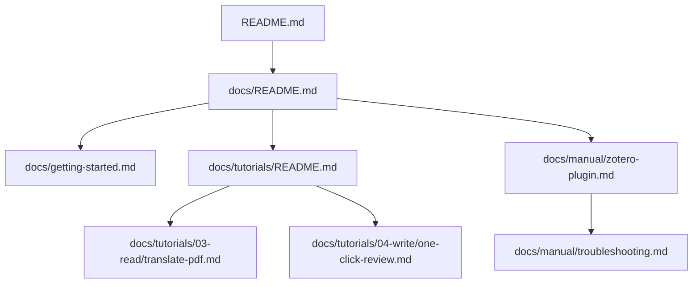

# wdcpclover/ai4paper

> Documentation d'un plugin Zotero et d'un service web payant d'aide à la lecture et à la revue de littérature.

## Le problème
Lire, traduire, classer et synthétiser des dizaines d'articles scientifiques oblige à jongler entre plusieurs outils.

## Ce que ça fait vraiment
Le dépôt ne contient que de la documentation : aucun code source. Il décrit un service commercial (plugin Zotero 7 à 10, web, mini-programme WeChat) : traduction de PDF, questions sur sa bibliothèque, revue de littérature générée, recherche de la zone de revue (classement) des journaux. Essai de 7 jours, puis abonnement ; la traduction intégrale est facturée à l'usage sur le solde du compte.

## Comment c'est branché
Schéma d'après le diagramme fourni (documentation seulement).



## Essayer
```bash
# Aucune commande : installer le fichier XPI depuis les Releases
# Zotero -> Outils -> Extensions -> engrenage -> Install Add-on From File
# Ou ouvrir app.ai4paper.pro dans le navigateur
```

## Coût et pièges
Compte obligatoire, essai gratuit de 7 jours, puis service payant ; la traduction complète débite le solde. Le code du service n'est pas publié et la licence est « tous droits réservés ».

## Ce que ce n'est pas
Pas un projet open source : ce dépôt n'héberge ni le plugin ni le serveur. Les 2,4 cents millions de références annoncées sont une base interne invérifiable ici. Interface et documentation surtout en chinois.

## Alternatives
Aucune alternative citée dans le README.

## Pour toi
À ignorer : produit fermé et payant, sans code à auditer ni à réutiliser, dont la valeur se mesure seulement en l'achetant.

