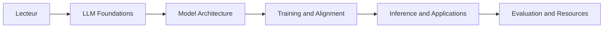

# wdndev/llm_interview_note

> Chinese-language notes on LLMs and interview questions, for anyone preparing for an AI role.

## The problem
Review the whole LLM scope (architecture, training, inference, RAG) for interviews, in one place.

## What it actually does
Collection of chapters: NLP basics, Transformer and attention (MHA/MQA/GQA), BERT, Llama, MoE, data, distributed training (DeepSpeed, Megatron), SFT and LoRA, inference (vLLM, TensorRT-LLM), RLHF (PPO, DPO), RAG and agents, evaluation and hallucinations, LangChain. The README also links to hands-on projects: tiny-llm-zh, tiny-rag, tiny-mcp, llama3-from-scratch-zh.

## How it is wired

## Trying it
No command: read the README or the "LLMs Interview Note" site.

## Cost and gotchas
Free. Written in Chinese; the author's own answers, not reviewed by third parties (he says so).

## What it is not
Not a product or executable code. No declared license: reuse of the content is not guaranteed.

## Alternatives
No alternative named; the README cites "AI 工程师八股" as a complement.

## For you
Worth watching if you read Chinese: a good LLM revision map; otherwise hard to use, and no license.
