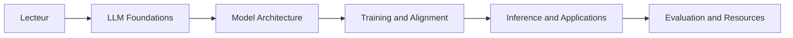

# wdndev/llm_interview_note

> Notes en chinois sur les LLM et questions d'entretien, pour qui prépare un poste en IA.

## Le problème
Réviser tout le périmètre LLM (architecture, entraînement, inférence, RAG) en vue d'entretiens, en un seul endroit.

## Ce que ça fait vraiment
Recueil de chapitres : bases NLP, Transformer et attention (MHA/MQA/GQA), BERT, Llama, MoE, données, entraînement distribué (DeepSpeed, Megatron), SFT et LoRA, inférence (vLLM, TensorRT-LLM), RLHF (PPO, DPO), RAG et agents, évaluation et hallucinations, LangChain. Le README renvoie aussi à des projets pratiques : tiny-llm-zh, tiny-rag, tiny-mcp, llama3-from-scratch-zh.

## Comment c'est branché

## Essayer
Aucune commande : lecture du README ou du site « LLMs Interview Note ».

## Coût et pièges
Gratuit. Rédigé en chinois ; réponses de l'auteur, non relues par des tiers (il l'indique).

## Ce que ce n'est pas
Pas un produit ni du code exécutable. Pas de licence déclarée : réutilisation du contenu non garantie.

## Alternatives
Aucune alternative nommée ; le README cite « AI 工程师八股 » comme complément.

## Pour toi
Surveiller si tu lis le chinois : bonne carte de révision LLM ; sinon peu exploitable, et licence absente.

