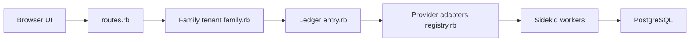

# we-promise/sure

> Self-hostable personal finance application, a community fork of the abandoned Maybe Finance.

## The problem
Tracking accounts, budgets and net worth without entrusting your data to a third-party service.

## What it actually does
Rails application: manual and synced accounts (Plaid, SimpleFIN), ledger, computed balances and holdings, budgets, goals, reports, file import, rules, JSON API. AI assistant (OpenAI/Anthropic, function-calling tools), Flutter and Tauri clients, Helm deployment.

## How it is wired


## Trying it
```bash
cd sure
cp .env.local.example .env.local
bin/setup
bin/dev
rake demo_data:default
```

## Cost and gotchas
Rails, PostgreSQL and Redis are required. Bank syncs and AI rely on external services (Plaid, OpenAI): keys and quotas are at your expense. One-click Render deployment offered.

## What it is not
Not a stable enterprise product: a project taken over by the community, 768 open issues. The name "Maybe" is forbidden in forks.

## Alternatives
No alternative named, apart from the archived Maybe Finance repository.

## For you
Worth watching: interesting as an example of an application with an LLM assistant and an API, but it is a personal finance app, not a data tool.
