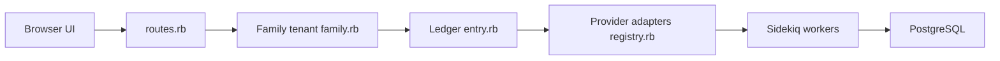

# we-promise/sure

> Application de finances personnelles auto-hébergeable, fork communautaire de Maybe Finance abandonné.

## Le problème
Suivre comptes, budgets et patrimoine sans confier ses données à un service tiers.

## Ce que ça fait vraiment
Application Rails : comptes manuels et synchronisés (Plaid, SimpleFIN), grand livre, soldes et positions calculés, budgets, objectifs, rapports, import de fichiers, règles, API JSON. Assistant IA (OpenAI/Anthropic, outils de fonctions), clients Flutter et Tauri, déploiement Helm.

## Comment c'est branché


## Essayer
```bash
cd sure
cp .env.local.example .env.local
bin/setup
bin/dev
rake demo_data:default
```

## Coût et pièges
Rails, PostgreSQL et Redis nécessaires. Les synchronisations bancaires et l'IA reposent sur des services externes (Plaid, OpenAI) : clés et quotas à ta charge. Rendu Render proposé en un clic.

## Ce que ce n'est pas
Pas un produit stable d'entreprise : projet repris par la communauté, 768 issues ouvertes. Nom « Maybe » interdit dans les forks.

## Alternatives
Aucune alternative nommée, hormis le dépôt Maybe Finance archivé.

## Pour toi
À surveiller : intéressant comme exemple d'application avec assistant LLM et API, mais c'est une app de finance perso, pas un outil de données.

