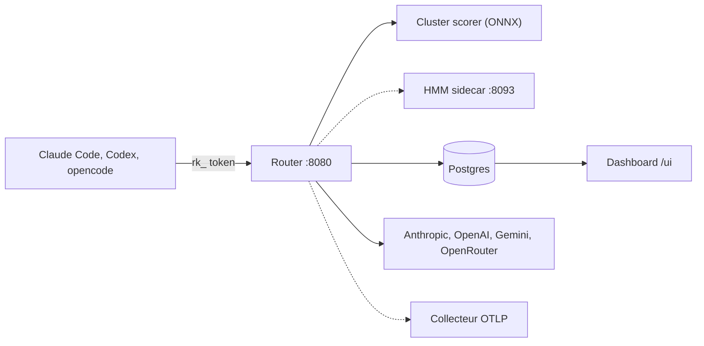

# weave-os/router

> LLM proxy that picks a model per request for Claude Code, Codex, opencode or your app.

## The problem
Sending every agent request to the same large model is expensive; choosing the model by hand, action by action, is impractical.

## What it actually does
Single entry point on `localhost:8080` that speaks Anthropic Messages, OpenAI Chat Completions and native Gemini, including streaming and tools.
For each incoming request, a cluster-based scorer (derived from Avengers-Pro) computes an embedding with a local ONNX model and picks among the enabled providers; an optional HMM policy runs as a sidecar.
Provider keys are encrypted in Postgres (BYOK), `rk_` keys on the client side, OTLP traces, `/ui` dashboard.
The `npx` installer modifies the config of Claude Code, Codex, opencode or pi, with on/off commands.

## How it is wired


## Trying it
```bash
npx @weave-os/router
npx @weave-os/router --local
echo "OPENROUTER_API_KEY=sk-or-v1-..." >> .env.local
echo "ROUTER_ADMIN_PASSWORD=replace-with-a-strong-password" >> .env.local
make full-setup
curl -sS http://localhost:8080/v1/route -H "Authorization: Bearer rk_..." -d '...'
```

## Cost and gotchas
The quick start points to the **hosted** Weave router: your requests then go through their infrastructure. Self-hosted: Postgres via Docker, a provider key (OpenRouter recommended), Pub/Sub as soon as there are several replicas, a Google key for the HMM.

## What it is not
Not neutral for your tools: the installer rewrites `~/.codex/config.toml`, `opencode.json` or `settings.json`.
Cursor support is announced as early beta.
Truncated README: advanced settings are not covered here.

## Alternatives
No alternative named in the README.

## For you
Interesting for cutting the bill of coding agents, but self-hosted; measure the quality lost before rolling it out widely.
