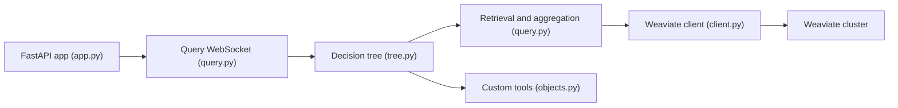

# weaviate/elysia

> Decision-tree agent platform that queries Weaviate collections, for RAG teams.

## The problem
Agents given access to every tool at each step get lost; querying your vector data in natural language takes a lot of assembly.

## What it actually does
A tree of predefined nodes is driven by a decision agent that sees the history and chooses the next tool. Built-in tools: Weaviate query and aggregation, chunking, text, visualization, summarization; custom tools via `@tool`. A FastAPI application with WebSocket serves the front end; DSPy handles the model calls. Collections must be preprocessed; configuration is per user.

## How it is wired


## Trying it
```bash
pip install elysia-ai
elysia start
```

## Cost and gotchas
Python 3.12 recommended; model API keys (OpenRouter advised, OpenAI for the vectorizer) and a Weaviate cluster (local or cloud). Small local models may time out on long contexts. Project in beta, maintenance "not at the level of production software" according to Weaviate.

## What it is not
Not a general-purpose agent framework: it is tailored to Weaviate. Not guaranteed to be rigorously maintained.

## Alternatives
No alternative named in the README.

## For you
Worth watching: interesting if you already use Weaviate for RAG, but in beta and not very active since February 2026.
