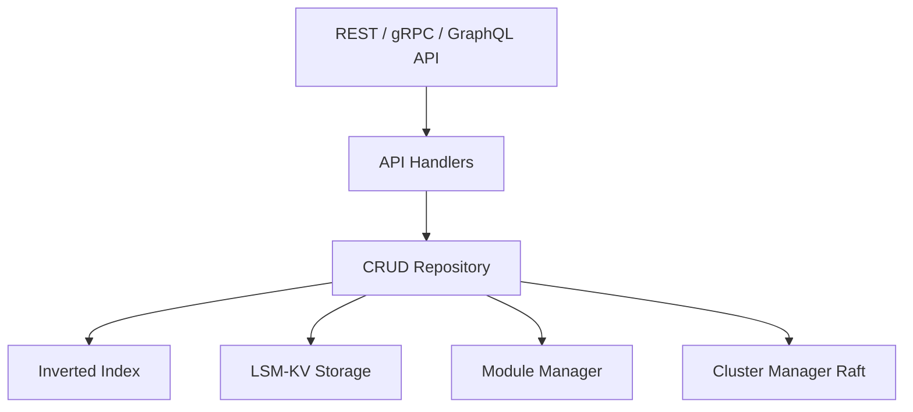

# weaviate/weaviate

> Open source vector database in Go: hybrid search, built-in RAG, multi-tenant.

## The problem
A production RAG requires storing objects and vectors, filtering, mixing BM25 and similarity, and scaling.

## What it actually does
It stores objects and vectors. Vectorization happens at import time through modules (OpenAI, Cohere, HF, Model2Vec…), or you supply your own vectors.
Hybrid BM25 + vector search, images, reranking and generation (RAG) are built in.
Multi-tenancy, Raft replication, RBAC, quantization and per-object TTL.
It exposes REST, gRPC and GraphQL APIs, with Python, JS, Java, Go and C# clients.

## How it is wired


## Trying it
```bash
docker compose up -d
pip install -U weaviate-client
npx skills add weaviate/agent-skills
```

## Cost and gotchas
It is free when self-hosted, and Weaviate Cloud is paid. External vectorizers (OpenAI…) add their own bill.

## What it is not
It is not an embedded library: it is a server you have to operate. GitHub does not identify the license.

## Alternatives
The README names no competing database. It mentions Verba and Elysia, two demos from the same vendor.

## For you
Adopt: it is a mature vector database, with hybrid search and local vectorization via Docker Compose. A safe choice for your RAGs.
