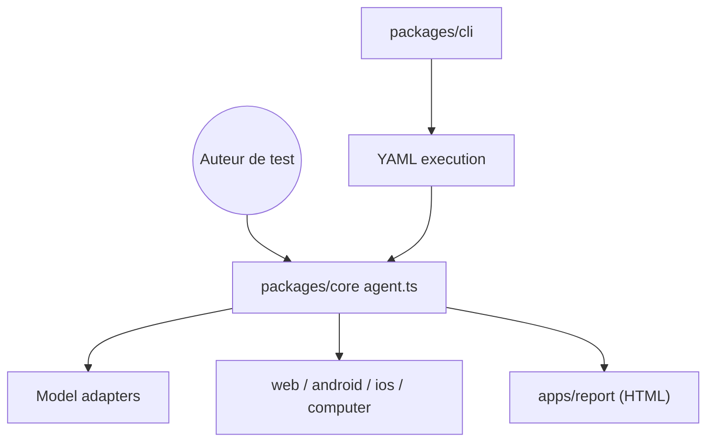

# web-infra-dev/midscene

> Natural-language E2E testing framework driving web, mobile and desktop through screen vision.

## The problem
Selector-based E2E tests break as soon as the interface changes and ignore what the user actually sees.

## What it actually does
An agent reads screenshots, locates elements by their appearance, acts (click, typing, scrolling) and checks the visible result. Cases are written in YAML or through the JS API (`aiAct`, `aiWaitFor`, `aiAssert`). Platforms: web, Android, iOS, HarmonyOS, desktop. HTML reports with screenshots.

## How it is wired


## Trying it
```javascript
import { PlaywrightAgent } from '@midscene/web/playwright';
const agent = new PlaywrightAgent(page);
await agent.aiAct('Search for headphones and filter the results to prices under $100');
await agent.aiAssert('There are products in the search results, and each costs less than $100');
```

## Cost and gotchas
You must configure a vision model (GPT, Qwen, Doubao, Gemini, etc.), billed to you unless self-hosted. The README cites $0.59 for one benchmark run.

## What it is not
Not deterministic like a selector: decisions go through a model. The benchmark figures come from the README.

## Alternatives
Playwright and Puppeteer are cited as integrations, not as competitors.

## For you
Worth adopting if you test AI application interfaces: visual, cross-platform, your choice of models.
