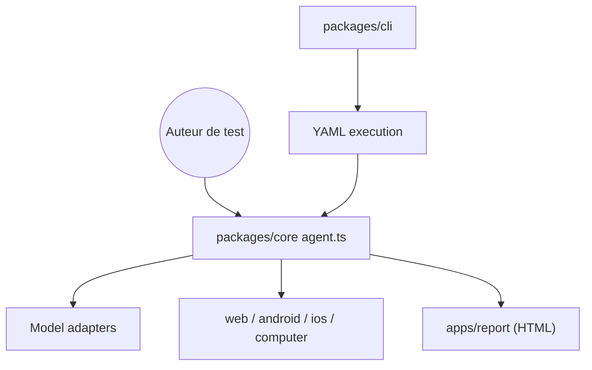

# web-infra-dev/midscene

> Framework de tests E2E en langage naturel pilotant web, mobile et bureau par vision d'écran.

## Le problème
Les tests E2E par sélecteurs cassent dès que l'interface change et ignorent ce que l'utilisateur voit réellement.

## Ce que ça fait vraiment
Un agent lit des captures d'écran, localise les éléments par leur apparence, agit (clic, saisie, défilement) et vérifie le résultat visible. Les cas s'écrivent en YAML ou via l'API JS (`aiAct`, `aiWaitFor`, `aiAssert`). Plateformes : web, Android, iOS, HarmonyOS, bureau. Rapports HTML avec captures.

## Comment c'est branché


## Essayer
```javascript
import { PlaywrightAgent } from '@midscene/web/playwright';
const agent = new PlaywrightAgent(page);
await agent.aiAct('Search for headphones and filter the results to prices under $100');
await agent.aiAssert('There are products in the search results, and each costs less than $100');
```

## Coût et pièges
Il faut configurer un modèle vision (GPT, Qwen, Doubao, Gemini, etc.), facturé à ta charge sauf modèle auto-hébergé. Le README cite 0,59 $ pour une exécution de benchmark.

## Ce que ce n'est pas
Pas déterministe comme un sélecteur : les décisions passent par un modèle. Les chiffres de benchmark viennent du README.

## Alternatives
Playwright et Puppeteer sont cités comme intégrations, pas comme concurrents.

## Pour toi
À adopter si tu testes des interfaces d'applications IA : visuel, multiplateforme, modèles au choix.

