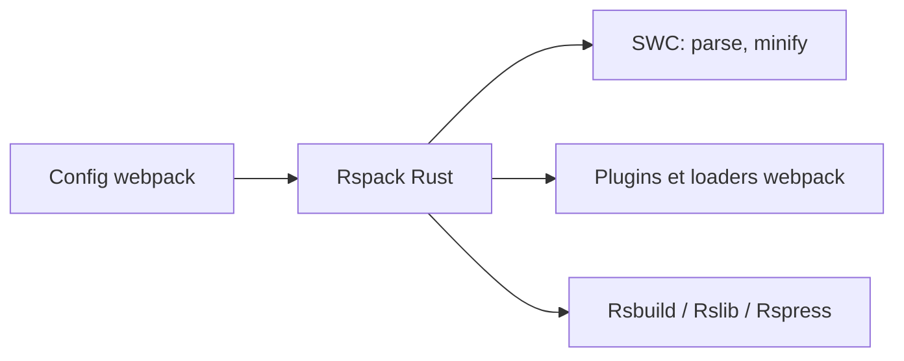

# web-infra-dev/rspack

> Rust-based web bundler, compatible with the webpack API, to replace webpack with shorter build times.

## The problem
webpack builds become slow on large front-end projects.

## What it actually does
Reuses the webpack API, its loaders and plugins, with incremental compilation for HMR, Module Federation, tree shaking and minification. Part of Rstack (Rsbuild, Rslib, Rspress, Rsdoctor, Rstest, Rslint). Built on SWC and NAPI-RS.

## How it is wired

## Trying it
No command in the README; it points to "Quick start" in the docs.

## Cost and gotchas
Free. Several doc lines (0.x, 1.x, 2.x): check the version.

## What it is not
Not a 100% replacement for webpack; compatibility is claimed, not detailed here. Benchmarks are on external sites.

## Alternatives
Rolldown, Vite, Turbopack, webpack: mentioned in the acknowledgments, without a comparison.

## For you
Ignore: a front-end bundling problem outside your data/AI area.
