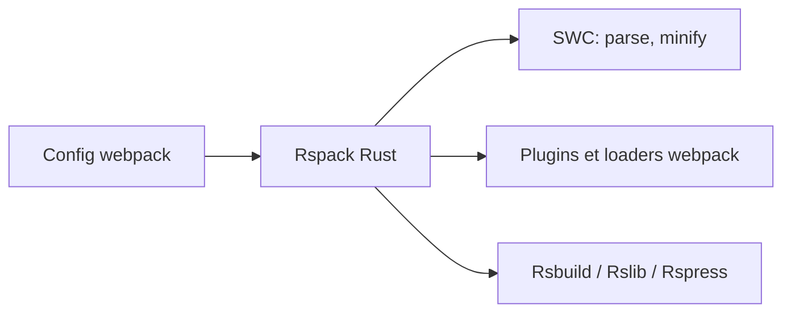

# web-infra-dev/rspack

> Bundler web en Rust, compatible avec l'API webpack, pour remplacer webpack à moindre temps de build.

## Le problème
Les builds webpack deviennent longs sur les gros projets front.

## Ce que ça fait vraiment
Reprend l'API webpack, ses loaders et plugins, avec compilation incrémentale pour le HMR, Module Federation, tree shaking et minification. Fait partie de Rstack (Rsbuild, Rslib, Rspress, Rsdoctor, Rstest, Rslint). S'appuie sur SWC et NAPI-RS.

## Comment c'est branché

## Essayer
Aucune commande dans le README ; renvoi à « Quick start » dans la doc.

## Coût et pièges
Gratuit. Plusieurs lignes de doc (0.x, 1.x, 2.x) : vérifier la version.

## Ce que ce n'est pas
Pas un remplaçant à 100 % de webpack ; la compatibilité est annoncée, pas détaillée ici. Les benchmarks sont sur des sites externes.

## Alternatives
Rolldown, Vite, Turbopack, webpack : cités dans les remerciements, sans comparatif.

## Pour toi
Ignorer : problème de bundling front hors de ta zone data/IA.

