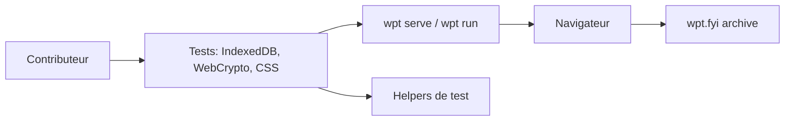

# web-platform-tests/wpt

> Cross-browser web platform test suite, for browser vendors and standards authors.

## The problem
Without shared tests, each browser interprets web specifications its own way and sites break from one engine to another.

## What it actually does
Tests (files, IndexedDB, WebCrypto, cookies, CSS, sensors, AI APIs) that can be run in a browser. The `wpt` command provides `serve`, `run`, `lint`, `manifest`, `install`, `serve-wave`. Results are archived on wpt.fyi. The repo does not implement the APIs under test. LLM policy: acceptable for writing tests, not for discussion.

## How it is wired


## Trying it
```bash
git pull --prune
./wpt lint
python wpt [command]
```

## Cost and gotchas
Free. Many branches are created/deleted: the README recommends `--prune`. On Windows, prefix with `python` and disable line-ending conversion.

## What it is not
Not a tool for testing your application: it tests browsers.

## Alternatives
No alternative named in the README.

## For you
Ignore: useful only for a browser engine; nothing for data/AI/MLOps work.
