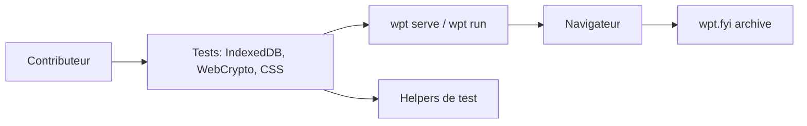

# web-platform-tests/wpt

> Suite de tests inter-navigateurs de la plateforme web, pour éditeurs de navigateurs et rédacteurs de standards.

## Le problème
Sans tests partagés, chaque navigateur interprète les spécifications web à sa manière et les sites cassent d'un moteur à l'autre.

## Ce que ça fait vraiment
Des tests (fichiers, IndexedDB, WebCrypto, cookies, CSS, capteurs, API IA) exécutables dans un navigateur. La commande `wpt` fournit `serve`, `run`, `lint`, `manifest`, `install`, `serve-wave`. Les résultats sont archivés sur wpt.fyi. Le dépôt n'implémente pas les API testées. Politique LLM : acceptable pour écrire des tests, pas pour discuter.

## Comment c'est branché


## Essayer
```bash
git pull --prune
./wpt lint
python wpt [command]
```

## Coût et pièges
Gratuit. Beaucoup de branches créées/supprimées : le README recommande `--prune`. Sous Windows, préfixer par `python` et désactiver la conversion de fins de ligne.

## Ce que ce n'est pas
Pas un outil pour tester ton application : il teste les navigateurs.

## Alternatives
Aucune alternative nommée dans le README.

## Pour toi
À ignorer : utile seulement pour un moteur de navigateur ; rien pour le travail data/IA/MLOps.

