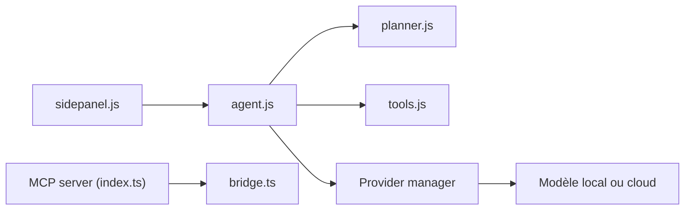

# webbrain-one/webbrain

> A browser extension that puts an AI agent in a side panel to read, chat about and automate pages.

## The problem
An agent without a connected browser starts disconnected and stumbles on login screens; querying a page forces copy-pasting.

## What it actually does
A side panel with three modes: Ask (read-only), Act (clicks, typing, uploads) and Dev (source, network, reversible changes). It reads pages through the accessibility tree, plans before acting, chains up to 195 steps, records reusable workflows, schedules tasks and watches pages. Model of your choice: local server (llama.cpp, Ollama, vLLM), cloud (106 provider profiles) or a managed default model. An MCP server delegates tasks from Claude Code, Codex or Cursor.

## How it is wired


## Trying it
```bash
git clone https://github.com/webbrain-one/webbrain.git
npm run build:chrome
claude mcp add --transport stdio webbrain -- npx -y @webbrain/mcp-server
```

## Cost and gotchas
The default model (Compass 1.0) needs no key; cloud APIs are at your expense. Local models require at least 16k tokens of context. Firefox is "significantly weaker" than Chrome; the MCP bridge only works under Chromium.

## What it is not
Not a headless framework: it runs in your real browser, with your open sessions, which widens the risk surface. License not identified by GitHub. The README points to a document on known gaps in prompt injection defense.

## Alternatives
No alternative named in the README.

## For you
Worth watching: interesting for automating authenticated web tasks with a local model, but the license is unclear and the agent holds your sessions: stick to Ask mode at first.
