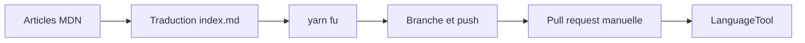

# webdoky/content

> Ukrainian translation of the MDN articles, with helper scripts and LanguageTool spell checking.

## The problem
The reference web documentation does not exist in Ukrainian for local developers.

## What it actually does
Contains the translated MDN articles. A LanguageTool check runs when a PR is opened, with exception files and disabled-rules files. The `fu` and `fux` scripts create a branch based on the modified file's path, commit and push; the PR remains manual.

## How it is wired
Simplified diagram based on the sheet, no diagram provided.



## Trying it
```bash
yarn finishupdate
yarn fu
yarn fux
```

## Cost and gotchas
Free. Node and yarn are required for the scripts. A license is present but unidentified; the content falls under its own license (see the repository). README written in Ukrainian.

## What it is not
Not a software tool: it is a corpus of translations.

## Alternatives
No alternative named in the README.

## For you
Ignore: web documentation in Ukrainian, of no value for your data/AI work.
