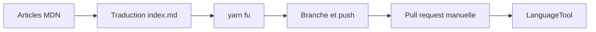

# webdoky/content

> Traduction ukrainienne des articles MDN, avec scripts d'aide et contrôle orthographique LanguageTool.

## Le problème
La documentation web de référence n'existe pas en ukrainien pour les développeurs locaux.

## Ce que ça fait vraiment
Contient les articles MDN traduits. Une vérification LanguageTool s'exécute à l'ouverture d'une PR, avec fichiers d'exceptions et de règles désactivées. Les scripts `fu` et `fux` créent une branche d'après le chemin du fichier modifié, committent et poussent ; la PR reste manuelle.

## Comment c'est branché
Schéma simplifié d'après la fiche, sans diagramme fourni.



## Essayer
```bash
yarn finishupdate
yarn fu
yarn fux
```

## Coût et pièges
Gratuit. Node et yarn requis pour les scripts. La licence est présente mais non identifiée ; le contenu relève d'une licence propre (voir le dépôt). README rédigé en ukrainien.

## Ce que ce n'est pas
Pas un outil logiciel : c'est un corpus de traductions.

## Alternatives
Aucune alternative nommée dans le README.

## Pour toi
À ignorer : documentation web en ukrainien, sans valeur pour ton travail data/IA.

