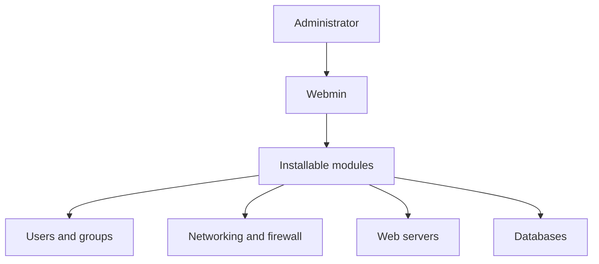

# webmin/webmin

> Web-based administration interface for Unix servers, extensible through modules, for system administrators.

## The problem
Configuring users, disks, services and server applications by hand, in configuration files, is slow and error-prone.

## What it actually does
Webmin exposes in a browser the configuration of the system (users, quotas, mounts, services, network) and of applications such as BIND, Apache, PHP and MySQL, through 116 standard modules. Virtualmin and Usermin extend it. The diagram does not show the internal paths between modules.

## How it is wired


## Trying it
```bash
# Aucune commande dans le README : voir webmin.com/download
```

## Cost and gotchas
Free. Perl 5.10 or later (not in the prerequisites list). A web administration panel with root access is an attack surface to protect.

## What it is not
Not a monitoring or container orchestration tool. The premium version of Virtualmin is a separate product.

## Alternatives
- Virtualmin: web hosting panel built on Webmin.
- Usermin: user-focused subset.

## For you
Ignore: general-purpose system administration panel; in MLOps you have better tools (infrastructure as code, containers).
