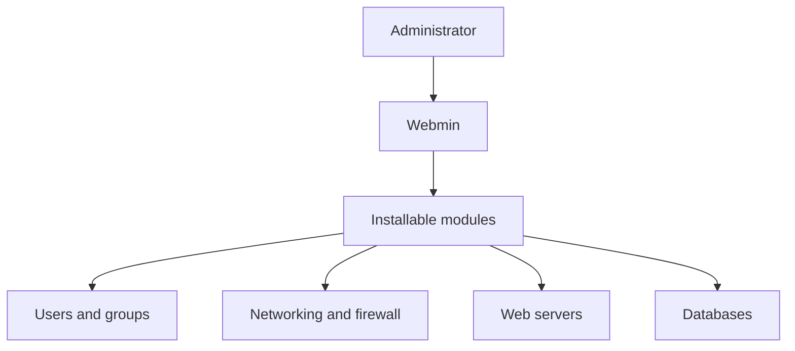

# webmin/webmin

> Interface web d'administration de serveurs Unix, extensible par modules, pour administrateurs système.

## Le problème
Configurer utilisateurs, disques, services et applications serveur à la main, en fichiers de configuration, est lent et sujet aux erreurs.

## Ce que ça fait vraiment
Webmin expose dans un navigateur la configuration du système (utilisateurs, quotas, montages, services, réseau) et des applications comme BIND, Apache, PHP et MySQL, par 116 modules standard. Virtualmin et Usermin l'étendent. Le diagramme ne montre pas les chemins internes entre modules.

## Comment c'est branché


## Essayer
```bash
# Aucune commande dans le README : voir webmin.com/download
```

## Coût et pièges
Gratuit. Perl 5.10 ou plus (hors liste de prérequis). Un panneau d'administration web avec accès root est une surface d'attaque à protéger.

## Ce que ce n'est pas
Ce n'est pas un outil de supervision ni d'orchestration de conteneurs. La version premium de Virtualmin est un produit séparé.

## Alternatives
- Virtualmin : panneau d'hébergement web bâti sur Webmin.
- Usermin : sous-ensemble centré sur les utilisateurs.

## Pour toi
À ignorer : panneau d'administration système généraliste, tu as de meilleurs outils (infra as code, conteneurs) en MLOps.

