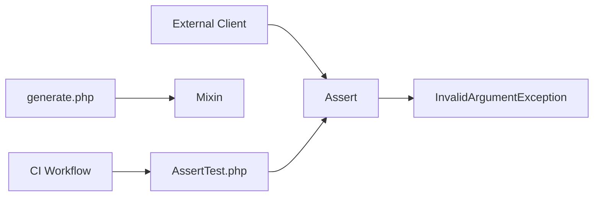

# webmozarts/assert

> PHP assertion library to validate inputs and outputs, with readable error messages.

## The problem
Validating a method's arguments takes a lot of repetitive code, and the error messages are often unusable.

## What it actually does
The `Assert` class offers checks on types, comparisons, strings, files, objects and arrays, which throw an `InvalidArgumentException`. The `all*` and `nullOr*` prefixes apply to every check. Custom messages follow a consistent parameter order.

## How it is wired


## Trying it
```bash
composer require webmozart/assert
```

## Cost and gotchas
Free, installed through Composer. Nothing hidden.

## What it is not
Not a form or schema validator: these are guard clauses that throw an exception.

## Alternatives
- beberlei/assert: the project's inspiration, but with an irregular order of `%s` placeholders.

## For you
Ignore: a PHP library, outside your data / AI stack.
